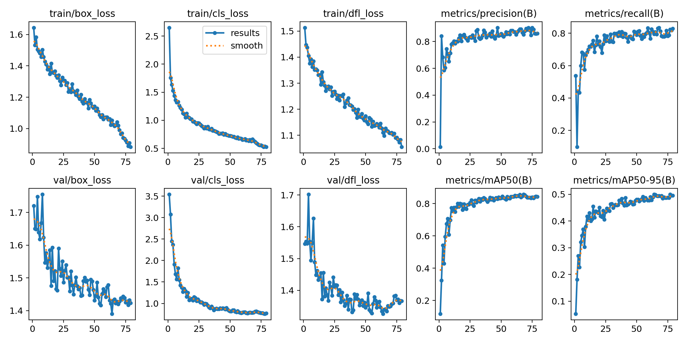
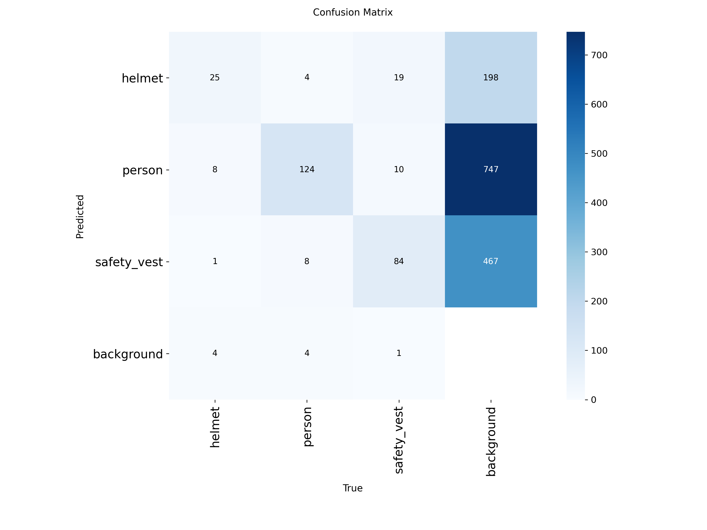
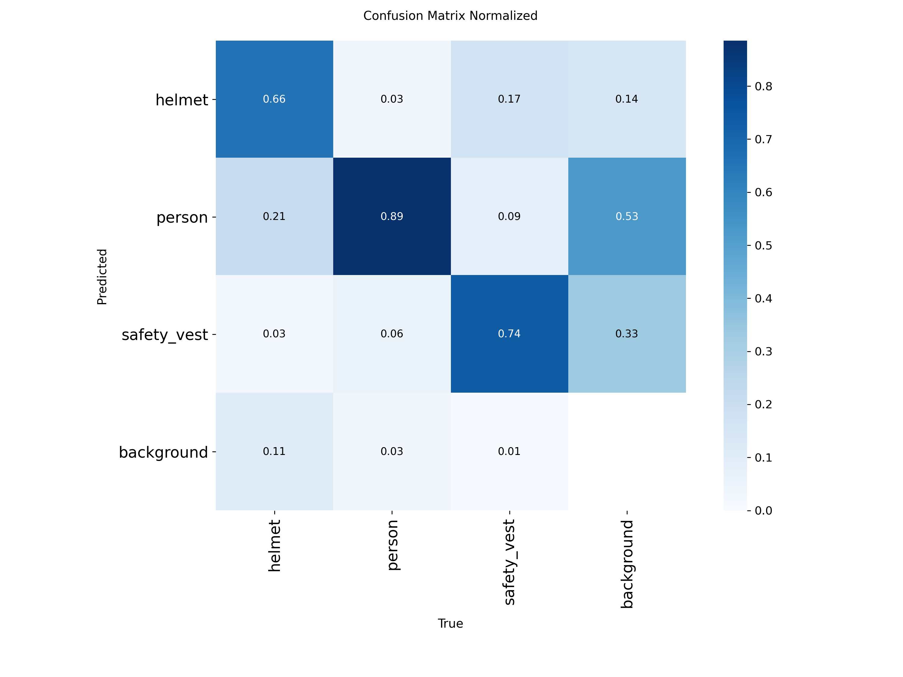
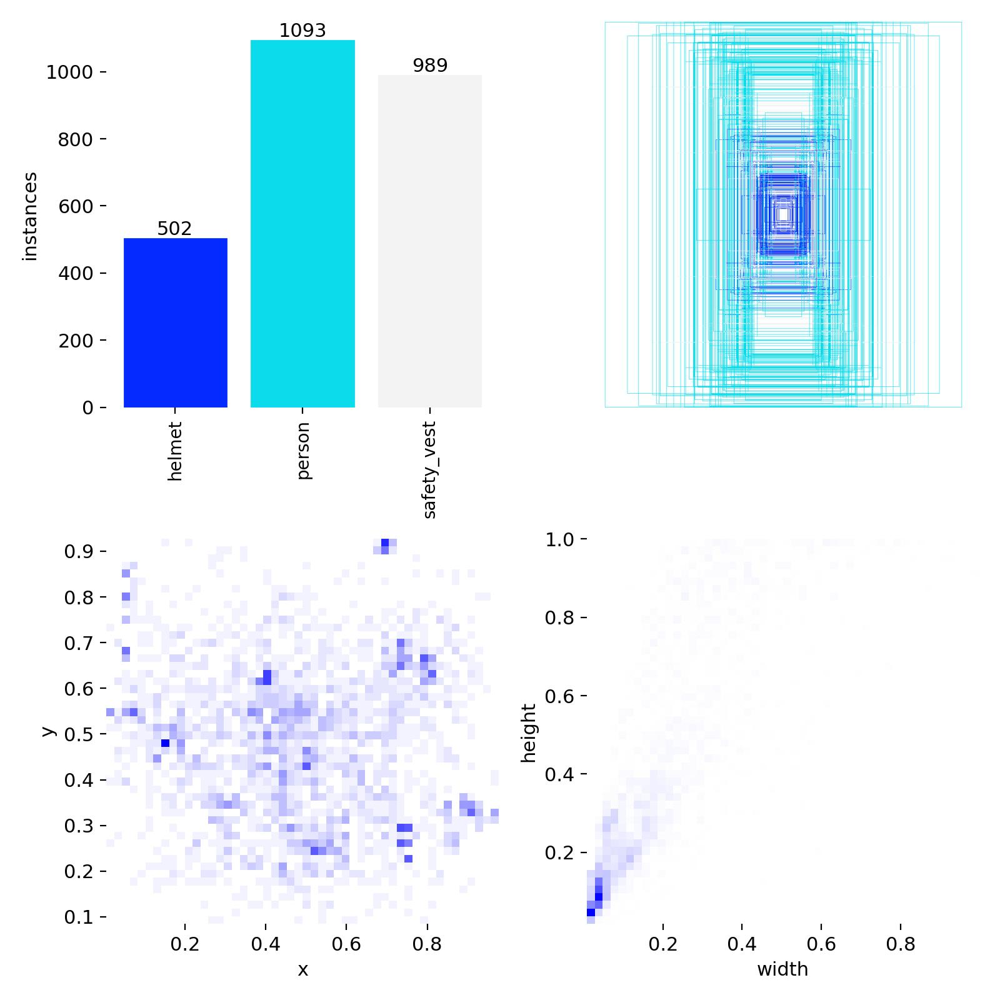
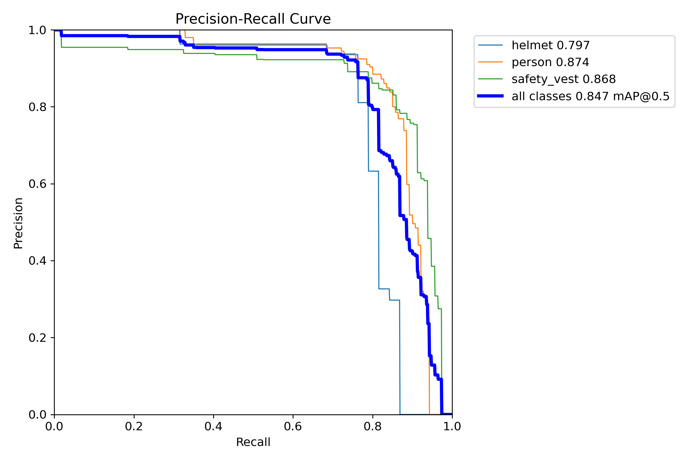
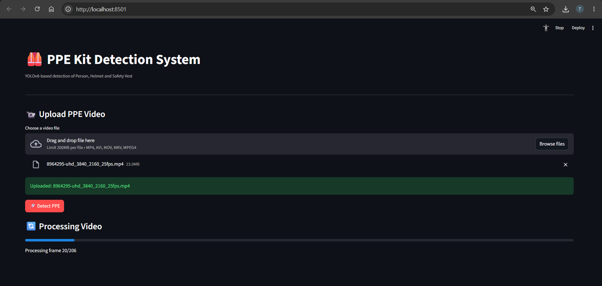
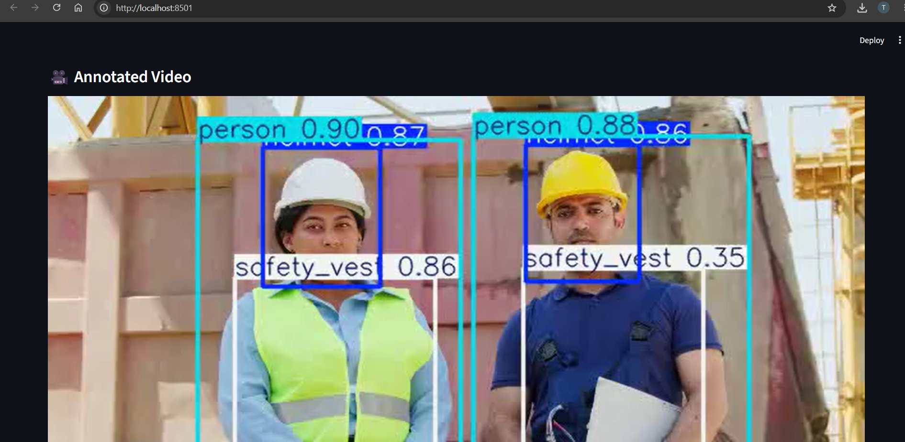

# PPE Kit Detection Using YOLOv8

## Project Overview

This project implements a computer-vision-based Personal Protective Equipment (PPE) detection system using YOLOv8. It detects three classes in images and videos: **Person, Helmet, and Safety Vest**.

The trained model is integrated into a Streamlit web application that allows users to upload a video, run detection, view the annotated output, and download the processed video.

## Technologies Used

- Python
- YOLOv8n and Ultralytics
- Roboflow
- Google Colab
- NVIDIA Tesla T4 GPU
- PyTorch
- OpenCV
- Streamlit
- FFmpeg
- Visual Studio Code

## Dataset

A subset of 500 images was selected from a larger PPE dataset for this experiment.

| Split | Images |
|---|---:|
| Training | 400 |
| Validation | 50 |
| Testing | 50 |
| Total | 500 |

The dataset contains three classes:

1. Helmet
2. Person
3. Safety Vest

The dataset was organized in YOLO format, with images and corresponding bounding-box label files.

## Model Training

The model was trained using a pretrained YOLOv8n checkpoint on Google Colab with an NVIDIA Tesla T4 GPU.

| Parameter | Value |
|---|---|
| Model | YOLOv8n |
| Image size | 640 × 640 |
| Batch size | 16 |
| Planned epochs | 80 |
| Training stopped | 79 epochs |
| Training device | NVIDIA Tesla T4 GPU |

The trained weights are saved as `best.pt`.

## Test Results

The model was evaluated on an independent test set of 50 images containing 348 annotated objects.

| Metric | Result |
|---|---:|
| Precision | 82.8% |
| Recall | 82.4% |
| mAP@50 | 86.8% |
| mAP@50–95 | 50.7% |

These results apply to the evaluated test set. Predictions on unseen videos may differ.

## Streamlit Dashboard

The dashboard supports:

- Uploading a video
- Detecting persons, helmets, and safety vests
- Displaying detection counts
- Generating an annotated video
- Playing the processed video
- Downloading the output video

OpenCV handles video-frame processing, while FFmpeg converts the result to an H.264 MP4 format for browser playback.

## How to Run

### 1. Clone the repository

```bash
git clone YOUR_GITHUB_REPOSITORY_URL
cd PPE_KIT_Detection
```

### 2. Install dependencies

```bash
pip install -r requirements.txt
```

Install FFmpeg separately and make sure it is available in your system PATH.

### 3. Check the model file

Place `best.pt` in the same directory as `app.py`.

### 4. Start the dashboard

```bash
streamlit run app.py
```

Open the local URL shown in the terminal, normally `http://localhost:8501`.

## Limitations

- The model may produce false positives or miss PPE in unfamiliar environments.
- The model detects the three trained classes; it does not directly classify PPE violations.
- Detection performance depends on image quality, lighting, camera angle, and similarity to the training data.

## Future Improvements

- Expand the dataset with more diverse images.
- Reduce false-positive detections.
- Improve inference speed.
- Add a separate PPE compliance-analysis layer.

## Authorwhat about

Developed as a computer-vision and deep-learning project.

## Results and Screenshots
### Overall model performance


### Training Results


### Confusion Matrix


### Normalized Confusion Matrix


### Dataset Labels


### Precision-Recall Curve


### Streamlit Dashboard


### Final PPE Detection

